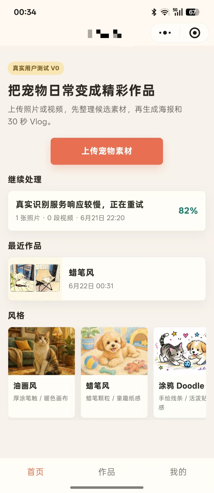
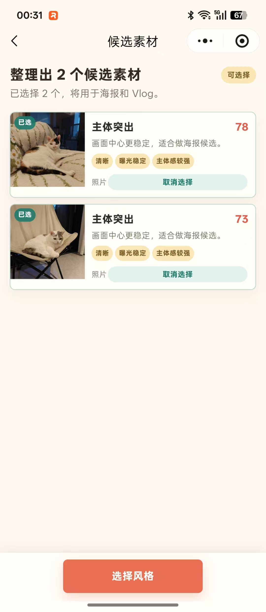
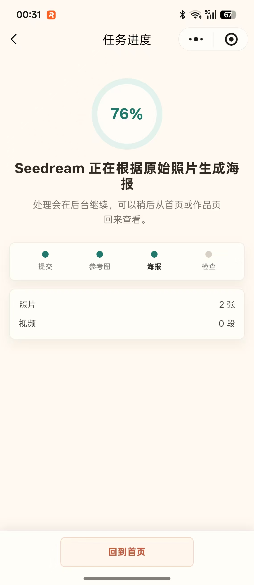
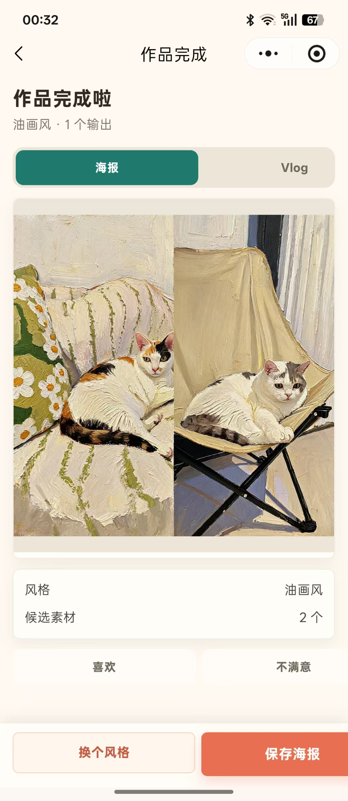
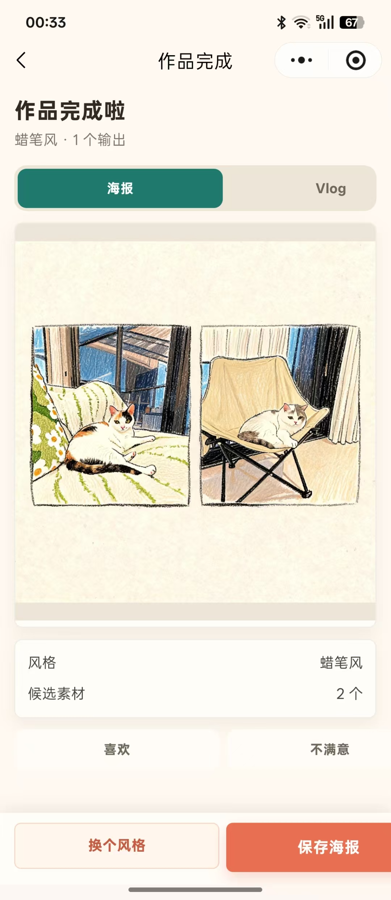

# 萌宠时刻 · Pet Moments AIGC

从一组手机照片或一段宠物视频出发，在微信小程序里挑选值得保留的瞬间，再把它们做成一张海报或一段风格统一的短片。设计风格覆盖油画、蜡笔和手绘涂鸦。

## 小程序与作品

点击缩略图可查看原图。

<table><tr>
<td><a href="media/1.png"></a></td>
<td><a href="media/2.png"></a></td>
<td><a href="media/3.png"></a></td>
</tr><tr>
<td><a href="media/4.png"></a></td>
<td><a href="media/5.png"></a></td>
</tr></table>

## 素材处理

小程序收集照片或视频中的宠物候选帧，由用户选出要保留的画面。项目使用 Seedream 和 Seedance 生成图片与视频。[风格预设](demo/style_presets.py)同时定义正向和负向提示词，并单独约束视频画风，让同一只宠物的花色、轮廓和笔触在不同输出中保持一致。

## 在本地试做一张海报

仓库收录了原项目的 [Pillow 排版模块](demo/local_template.py)。给它一至九张自己的宠物照片，就能离线生成 1080 × 1080 的九宫格构图。这个示例运行时无需生成服务账号。

```sh
python3 -m venv .venv
. .venv/bin/activate
python -m pip install -r requirements.txt
python demo/render_poster.py cat-1.jpg cat-2.jpg --style crayon --output poster.jpg
```

将示例文件名换成自己的图片路径。可选风格为 `oil_painting`、`crayon` 和 `doodle`。
